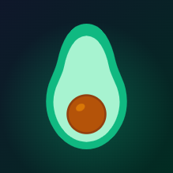

<p align="center">
  
</p>

<h1 align="center">Platito</h1>

A mobile-first food, workout and nutrition tracker backed by a **Kotlin service and PostgreSQL** (see [`primate-backend/`](primate-backend/README.md)). Log meals built from your own recipes, track workouts, follow calorie-deficit plans, and watch your progress in charts.

Built with Next.js 14 (App Router), React 18, Tailwind CSS and Recharts; the backend uses Kotlin, Spring Boot, PostgreSQL and Liquibase.

## Features

- **Today** – daily calorie budget, macro rings and the day's meal log. Every active plan appears as a swipeable card (earliest first), and the selected plan drives the budget.
- **Log meals** – pick a dish and portion; calories, macros and micronutrients are computed from your recipes and the ingredient catalog. Meals can be deleted.
- **Workouts** – log and delete workouts with calories burnt.
- **Recipes** – build dishes from ingredients, expand a dish for its ingredient and micronutrient breakdown, and edit a recipe's ingredients (recipes cannot be deleted).
- **Trends** – N-day average intake, macro and calorie charts, and deficit projections.
- **Plans** – create, edit and soft-delete plans, each with a target weight, resting calories, start date and optional comment. A plan is `ACTIVE` once its start date arrives, otherwise `INACTIVE`; deleted plans stay visible as `DELETED`.
- **Profile** – edit user details and manage plans.
- **Weekly export** – draft a shareable nutrition and activity report with seven-day trends, including calories consumed versus burned and estimated body-fat versus wet-muscle changes. Copy or share it, or open WhatsApp with the report prefilled for a recipient you choose.
- **Mobile navigation** – the bottom menu hides while scrolling down and returns while scrolling up; meal and workout submit buttons move with it.

## Getting started

### Prerequisites

- Node.js 18 or later
- JDK 21 and Docker (for the backend and its PostgreSQL database)

### Install and run

```bash
# 1. Backend and database (see primate-backend/README.md)
cd primate-backend && cp .env.example .env    # set AUTH_SECRET and GARMIN_API_KEY_ENCRYPTION_KEY
docker compose up --build -d
cd ..

# 2. Web app
npm install
cp .env.example .env.local            # same AUTH_SECRET; BACKEND_URL=http://localhost:8080
npm run dev
```

Open <http://localhost:3000>.

### Configuration

Set these in `.env.local`:

| Variable | Description |
| --- | --- |
| `AUTH_SECRET` | Signs session cookies; must match the backend's `AUTH_SECRET` |
| `BACKEND_URL` | Base URL of the Kotlin backend, default `http://localhost:8080` |

Moving from the Google Sheets version? Run `scripts/export-sheets-to-sql.mjs` once. Steps are in [primate-backend/README.md](primate-backend/README.md#migrating-from-google-sheets).

## Project structure

```
app/            Next.js app router: page.tsx (main screen) and api/ routes
  api/          Thin proxies to the backend, plus login/signup cookie handling
primate-backend/ Kotlin + Spring Boot service: PostgreSQL, Liquibase, Garmin sync jobs
components/     UI: BottomNav, PlanCarousel, ProfileScreen, TrendsView, ...
lib/            backend.ts (backend client/proxy), authSession.ts, garminClient.ts
scripts/        Password hash helper and the one-off Sheets → SQL export
types/          Shared TypeScript types
```

## Scripts

| Command | Purpose |
| --- | --- |
| `npm run dev` | Start the dev server |
| `npm run build` | Production build |
| `npm start` | Run the production build |
| `npx tsc --noEmit` | Type-check |

## Notes

- Meal and workout deletes check that the entry still matches what the client showed. Plans are soft-deleted.
- Plan totals only count activity on or after the plan's start date.
- Garmin data is synced by backend jobs; the browser never handles Garmin tokens.
- The `app/icon-mocks` and `app/export-mocks` directories are local-only prototypes and are git-ignored; they are not part of the deployed app.
- The Manrope font is loaded with `next/font/google`, so production builds need access to Google Fonts during compilation.
